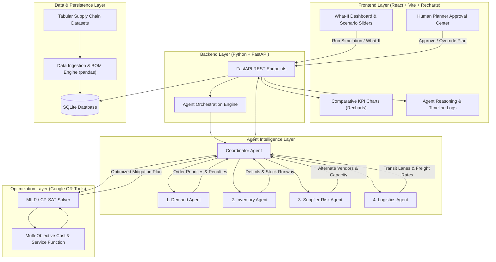

# Project Plan: AI Agents for Resilient Supply Chain Manufacturing

> **GDGoC Agentic AI Hackathon Project Roadmap & Architectural Specification**  
> A detailed blueprint covering agent design, mathematical optimization, planning comparisons, simulation dashboards, evaluation metrics, and development milestones.

---

## 1. Executive Summary & Problem Scope

In modern discrete manufacturing (such as electronics, automotive, or industrial machinery), assembly lines depend on hundreds of precision components delivered under lean, Just-in-Time schedules. A sudden seven-day outage of a critical component supplier—whether triggered by natural disasters, cyber incidents, equipment failures, or financial distress—threatens the entire manufacturing schedule.

This project delivers an **autonomous multi-agent supply chain resilience platform** that:
1. Detects and assesses a **seven-day shutdown of a critical supplier**.
2. Coordinates **four specialized domain AI agents** via a **Coordinator Agent**.
3. Solves a multi-objective mathematical optimization problem using **Google OR-Tools**.
4. Benchmarks **three distinct planning approaches** (Baseline, Heuristic, and Optimization).
5. Provides an interactive **What-If Dashboard** for visual impact analysis.
6. Enforces **Human-in-the-Loop** verification before executing mitigation actions.

---

## 2. System Architecture

The system is organized into modular frontend, backend, optimization, and data layers, ensuring clean separation of concerns and maintainability.



### Component Boundaries
- **`frontend/`**: Pure presentation and interactivity. Does not contain business logic or optimization solvers. Consumes structured JSON responses from the backend API.
- **`backend/`**: Hosts FastAPI routes, agent execution logic, and database interfaces. Coordinates asynchronous tasks and payload schemas.
- **`backend/optimization/`**: Encapsulates the Google OR-Tools mathematical formulation, objective functions, and constraint definitions.
- **`data/`**: Holds synthetic manufacturing datasets (Bills of Materials, supplier catalogs, inventory logs, purchase orders) and the local SQLite database.
- **`tests/`**: Unit tests for agent logic, solver validation, data transformations, and API contract tests.

---

## 3. Specialized AI Agents & Responsibilities

The multi-agent system mirrors real-world supply chain departments, allowing each agent to specialize in its respective domain before synthesizing enterprise-wide decisions.

```
                   ┌───────────────────────────┐
                   │     Coordinator Agent     │
                   └─────────────┬─────────────┘
          ┌──────────────┬───────┴───────┬──────────────┐
          ▼              ▼               ▼              ▼
   ┌─────────────┐┌─────────────┐┌─────────────┐┌─────────────┐
   │Demand Agent ││Inventory Ag ││Supplier Ag  ││Logistics Ag │
   └─────────────┘└─────────────┘└─────────────┘└─────────────┘
```

### 3.1. Demand Agent
- **Core Mission:** Protect customer delivery commitments and minimize SLA breach penalties.
- **Key Inputs:** 
  - Open customer orders and sales backlog.
  - Delivery due dates and customer priority tiers (e.g., Gold, Silver, Bronze).
  - Contractual SLA delay penalties ($/day/delayed unit).
- **Primary Responsibilities:**
  - Categorizes customer demand into critical vs. deferrable order lines.
  - Identifies customer orders dependent on the disrupted component.
  - Computes potential revenue at risk and daily delay penalties if production halts.
  - Recommends order rationing and delivery sequencing policies.
- **Agent Outputs:** Priority-ranked order backlog, daily penalty risk matrix, protected demand targets.

### 3.2. Inventory Agent
- **Core Mission:** Provide exact stock visibility, safety stock runway, and component deficit forecasts.
- **Key Inputs:**
  - Warehouse stock levels for raw materials, sub-assemblies, and finished goods.
  - Safety stock thresholds and reorder points.
  - Multi-level Bill of Materials (BOM) linking components to finished SKUs.
- **Primary Responsibilities:**
  - Performs BOM explosion to identify which finished products require the disrupted component.
  - Calculates Days of Inventory (DOI) and projects the exact day safety stock will deplete.
  - Tracks WIP (Work-in-Progress) inventory that can be completed without new parts.
  - Analyzes whether buffer stock can be borrowed from non-critical product lines.
- **Agent Outputs:** Stockout timeline (day-by-day burn down), exact net component deficit over 7 days, safety stock buffer status.

### 3.3. Supplier-Risk Agent
- **Core Mission:** Discover, evaluate, and qualify alternative suppliers to replace the shut-down vendor.
- **Key Inputs:**
  - Supplier master catalog (Tier-1 and Tier-2 suppliers).
  - Historical reliability ratings, quality certifications, and financial health scores.
  - Alternate supplier maximum daily capacities and production lead times.
  - Disruption alert details (Supplier ID, affected parts, 7-day outage duration).
- **Primary Responsibilities:**
  - Confirms the outage parameters of the primary supplier.
  - Queries the vendor catalog for qualified secondary suppliers manufacturing interchangeable parts.
  - Calculates supplier price premiums (e.g., +15% to +35% for expedited production slots).
  - Verifies whether alternate suppliers have sufficient spare capacity to fulfill the deficit.
- **Agent Outputs:** Qualified alternative supplier roster, available batch sizes, component surcharges, production lead times.

### 3.4. Logistics Agent
- **Core Mission:** Evaluate transportation routes, freight modes, and delivery speeds to expedite shipments.
- **Key Inputs:**
  - Available freight modes: Standard Ground Freight, Dedicated Expedited Trucking, Air Cargo.
  - Freight rate sheets (base shipping rates + expedited fuel and handling surcharges).
  - Transit times (e.g., Standard Ground: 4–5 days; Air Cargo: 1–2 days).
  - Route risk profiles (weather congestion, border clearance delays).
- **Primary Responsibilities:**
  - Evaluates shipping corridors connecting qualified alternate suppliers to manufacturing facilities.
  - Analyzes the speed vs. cost trade-off for each freight mode.
  - Identifies feasible shipping schedules capable of delivering parts before inventory depletes.
  - Calculates carbon footprint and logistics reliability scores.
- **Agent Outputs:** Ranked logistics routing options, carrier quotes, estimated delivery dates (ETAs), logistics risk flags.

---

### 3.5. Coordinator Agent
- **Core Mission:** The orchestrator and decision synthesizer that resolves conflicts, runs mathematical optimization, and builds actionable plans.
- **Primary Responsibilities:**
  1. **Workflow Orchestration:** Triggers the four domain agents in parallel and ensures all structured payloads are received.
  2. **Inter-Agent Arbitration:** Resolves conflicting agent goals:
     - *Demand Agent* demands immediate air cargo for all orders to protect SLAs.
     - *Supplier Agent* seeks the lowest unit purchase cost.
     - *Logistics Agent* highlights that air cargo on heavy items incurs massive premiums.
     - *Inventory Agent* calculates that only 40% of orders face immediate stockout.
  3. **Optimization Model Construction:** Converts agent outputs into decision variables, cost matrices, and linear constraints.
  4. **OR-Tools Execution:** Passes parameters to Google OR-Tools and verifies feasibility.
  5. **Scenario Assembly:** Generates the three comparative planning approaches (Baseline, Heuristic, Optimized).
  6. **Payload Packaging:** Formats recommendations into human-readable rationales and structured data for the frontend dashboard.

---

## 4. The Three Planning Approaches to Compare

To demonstrate the concrete value of agentic optimization, the system computes and compares three planning strategies for the same 7-day disruption event:

| Dimension | Approach 1: Baseline (Reactive / Business-As-Usual) | Approach 2: Heuristic (Rule-Based Panic) | Approach 3: Agentic Optimization (Google OR-Tools) |
| :--- | :--- | :--- | :--- |
| **Strategy Summary** | Take no proactive measures. Run production strictly from on-hand inventory until stock runs out. | Apply hard-coded rules: order 100% of missing components from the nearest alternate vendor via fastest air freight. | Jointly optimize multi-source order quantities, freight modes, safety stock burn, and production priority using MILP. |
| **Supplier Allocation** | Disrupted supplier only (0 units received during outage). | Single alternate supplier with fastest turnaround, regardless of unit price. | Multi-sourcing split: allocates orders across multiple qualified suppliers based on capacity and cost. |
| **Logistics Selection** | Standard existing shipments only. | 100% Air Cargo / expedited freight for all deficit parts. | Balanced logistics: Air Cargo for urgent Tier-1 customer parts; Expedited Ground for remaining demand. |
| **Order Prioritization** | Standard FIFO (First-In, First-Out) until assembly line stalls. | First-come, first-served until expedited parts arrive. | Strategic rationing: Gold-tier customer orders protected 100%; non-critical orders rescheduled within grace periods. |
| **Total Mitigation Cost** | Low upfront cash spend, but **severe SLA penalties and lost sales**. | **Extremely high spend** due to unoptimized rush surcharges and emergency air freight. | **Minimal total cost**; mathematically balances expediting fees against penalty avoidance. |
| **Fulfillment Rate** | Very Low (~30%–45% on affected lines). | High (~85%–90%), but achieved at unsustainable expense. | **Optimal (~92%–98%)**, achieving maximum fulfillment at lowest possible cost. |
| **Stockout Duration** | 4 to 6 full production downtime days. | 0 to 1 downtime days. | 0 downtime days on prioritized lines; graceful buffer management. |

---

## 5. Mathematical Optimization with Google OR-Tools

The Coordinator Agent utilizes **Google OR-Tools** (Linear Optimization / CP-SAT) to solve the supply chain recovery problem with mathematical precision.

### 5.1. Mathematical Formulation

#### Indices & Sets
- $t \in \{1, \dots, T\}$: Planning days in the simulation horizon ($T = 14$ days, covering the 7-day outage + recovery).
- $s \in S$: Suppliers (including primary supplier $s_0$ and alternate suppliers $s_1, s_2, \dots$).
- $m \in M$: Transportation modes (e.g., $m_1 = \text{Standard Ground}$, $m_2 = \text{Expedited Ground}$, $m_3 = \text{Air Cargo}$).
- $k \in K$: Finished goods / customer orders with priority weights $w_k$.

#### Decision Variables
- $X_{s, m, t} \ge 0$: Units of components ordered from supplier $s$ via shipping mode $m$ on day $t$.
- $I_t \ge 0$: Component inventory in warehouse at end of day $t$.
- $P_{k, t} \ge 0$: Units of finished product $k$ assembled on day $t$.
- $B_{k, t} \ge 0$: Backlogged (unfulfilled) units of order $k$ on day $t$.
- $Y_{s, m, t} \in \{0, 1\}$: Binary activation variable indicating if a shipment is dispatched.

#### Objective Function (Minimize Total Disruption Impact)
$$\min \quad \sum_{t} \left( \sum_{s, m} C^{\text{purchase}}_{s} \cdot X_{s,m,t} + \sum_{s, m} C^{\text{freight}}_{s,m} \cdot X_{s,m,t} + C^{\text{hold}} \cdot I_t + \sum_{k} C^{\text{penalty}}_{k} \cdot B_{k,t} \right)$$

Where:
- $C^{\text{purchase}}_{s}$: Unit cost from supplier $s$ (including shutdown premium).
- $C^{\text{freight}}_{s,m}$: Unit transportation cost from supplier $s$ using mode $m$.
- $C^{\text{hold}}$: Daily warehouse holding cost per component.
- $C^{\text{penalty}}_{k}$: Daily contract penalty for delayed customer order $k$.

#### Constraints
1. **Inventory Balance:**  
   $$I_t = I_{t-1} + \sum_{s, m} X_{s, m, t - L_{s,m}} - \sum_{k} \beta_k \cdot P_{k,t} \quad \forall t$$  
   *(where $L_{s,m}$ is the combined lead time of supplier $s$ and mode $m$, and $\beta_k$ is the BOM consumption requirement).*
2. **Disrupted Supplier Capacity:**  
   $$X_{s_0, m, t} = 0 \quad \forall t \in [1, 7], \forall m$$  
   *(Primary supplier delivers 0 units during the 7-day shutdown).*
3. **Alternate Supplier Capacity Limits:**  
   $$\sum_{m} X_{s, m, t} \le \text{Cap}_{s, t} \quad \forall s \neq s_0, \forall t$$
4. **Assembly Plant Capacity:**  
   $$\sum_{k} \alpha_k \cdot P_{k,t} \le \text{DailyHours} \quad \forall t$$
5. **Safety Stock Non-Negativity:**  
   $$I_t \ge \text{SafetyStockMin} \quad \text{(or penalized soft lower bound)} \quad \forall t$$
6. **Order Backlog Tracking:**  
   $$B_{k,t} = B_{k, t-1} + \text{Demand}_{k,t} - P_{k,t} \quad \forall k, t$$

---

## 6. What-If Dashboard & User Experience

The frontend web application provides manufacturing planners with an intuitive, dynamic control center:

```
┌──────────────────────────────────────────────────────────────────────────────┐
│  AI Agents for Resilient Supply Chain Manufacturing - What-If Dashboard      │
├──────────────────────────────────────────────────────────────────────────────┤
│ [Scenario Controls]                                                          │
│ Outage Duration: [━━━●━━━━━] 7 Days   Supplier Surcharge: [━━●━━━━] +20%     │
│ Alternate Lead Time: [━●━━━━━━] 2 Days   Demand Spike Toggle: [ OFF | ON ]   │
│                                            [ ▶ Run Agentic Simulation ]      │
├──────────────────────────────────────────────────────────────────────────────┤
│ [Three-Way Scenario Comparison]                                              │
│  ┌──────────────────────┐ ┌──────────────────────┐ ┌──────────────────────┐  │
│  │ 1. Baseline Plan     │ │ 2. Heuristic Plan    │ │ 3. OR-Tools Optimal  │  │
│  │ Total Cost: $148,000 │ │ Total Cost: $92,500  │ │ Total Cost: $41,200  │  │
│  │ Fulfillment: 38%     │ │ Fulfillment: 87%     │ │ Fulfillment: 96%     │  │
│  │ Downtime: 5.5 Days   │ │ Downtime: 1.0 Day    │ │ Downtime: 0.0 Days   │  │
│  └──────────────────────┘ └──────────────────────┘ └──────────────────────┘  │
├──────────────────────────────────────────────────────────────────────────────┤
│ [Visual Analytics (Recharts)]                                                │
│  ┌─────────────────────────────────┐  ┌─────────────────────────────────┐    │
│  │ 14-Day Inventory Runway Chart   │  │ Cost Trade-Off Breakdown        │    │
│  │ (Burn-down curves comparison)   │  │ (Purchasing vs Freight vs SLA)  │    │
│  └─────────────────────────────────┘  └─────────────────────────────────┘    │
├──────────────────────────────────────────────────────────────────────────────┤
│ [Agent Reasoning Audit Trail]                                                │
│  • Demand Agent: 45 Gold-tier units flagged; penalty risk = $22,000/day.     │
│  • Inventory Agent: Stockout projected on Day 3 without reorder.             │
│  • Supplier Agent: Supplier Beta has 600 units spare capacity at +18%.       │
│  • Logistics Agent: Air freight saves 3 days over ground; selected for Beta. │
├──────────────────────────────────────────────────────────────────────────────┤
│ [Human Planner Approval Gate]                                                │
│  Recommended Actions: 3 POs ready for approval ($28,400 commitment).         │
│  [ Review PO Details ]      [ ✕ Reject Plan ]      [ ✓ Approve & Execute ]   │
└──────────────────────────────────────────────────────────────────────────────┘
```

### Key UI Features
- **Interactive Sliders:** Adjust shutdown duration (1 to 14 days), supplier markup percentage, and freight expediting costs in real time.
- **Dynamic Recharts:**
  - *Inventory Burn-Down Graph:* Visualizes component stock dipping towards zero and recovering after expedited orders arrive.
  - *Cost Comparison Bar Graph:* Clearly isolates freight premiums, purchase surcharges, and SLA delay penalties across all three approaches.
  - *Order Fulfillment by Priority Tier:* Demonstrates protection of Gold and Silver customers.
- **Agent Intelligence Feed:** Live audit log displaying reasoning summaries, confidence levels, and trade-off rationales generated by each agent.
- **Human Approval Modal:** Clear summary of purchase orders and freight bookings ready for planner sign-off.

---

## 7. Evaluation Metrics

The system measures performance using both supply chain operational metrics and agentic AI computational metrics:

### 7.1. Operational Supply Chain KPIs
1. **Order Fulfillment Rate (%):**  
   $$\text{OFR} = \frac{\text{Total Customer Units Delivered On-Time}}{\text{Total Customer Units Demanded}} \times 100\%$$
2. **Total Disruption Cost ($):**  
   Sum of expediting costs, supplier surcharges, inventory holding, and SLA breach penalties incurred over the simulation window.
3. **Cost Savings vs. Heuristic ($ and %):**  
   Direct financial savings realized by using mathematical optimization over naive rule-based expediting.
4. **Assembly Downtime Hours:**  
   Total hours production lines sit idle due to missing parts during the 7-day outage.
5. **Time to Recovery (TTR - Days):**  
   Number of operating days from disruption onset until inventory and production rates return to normal operating levels.
6. **Tier-1 SLA Compliance (%):**  
   Percentage of high-priority customer contracts fulfilled without incurring penalties.

### 7.2. Agentic AI & Computational Metrics
1. **Multi-Agent Decision Latency (seconds):**  
   Total wall-clock time required for all four domain agents and the Coordinator Agent to assess data and generate proposals.
2. **Optimization Solve Time (milliseconds):**  
   Time taken by Google OR-Tools to solve the MILP problem to proven optimality.
3. **Reasoning Transparency & Traceability:**  
   100% of recommended purchase orders and freight choices link back to specific agent recommendations and solver constraints.

---

## 8. Human-in-the-Loop Approval Workflow

In real-world manufacturing, autonomous agents should not execute binding contracts or wire financial capital without explicit human oversight. Our architecture implements a strict **Human-in-the-Loop (HITL)** governance model:

```
[ Optimization Completed ]
            │
            ▼
[ Plan Status: PENDING_APPROVAL ]
            │
            ▼
┌───────────────────────────────────────┐
│       Human Planner Inspection        │
│  - Inspect Purchase Orders            │
│  - Review Carrier Bookings            │
│  - Check Total Financial Commitment   │
└───────────────────┬───────────────────┘
                    │
         ┌──────────┴──────────┐
         ▼                     ▼
   [ Approved ]          [ Rejected / Edited ]
         │                     │
         ▼                     ▼
[ Immutable Audit Log ]  [ Parameter Adjustment ]
[ Trigger PO Dispatch ]  [ Re-run Optimization  ]
```

### Approval States & Governance
1. **`PENDING_APPROVAL`:** The default state when optimization finishes. All suggested purchase orders and freight bookings remain tentative.
2. **Planner Inspection:** The planner can view line-item details:
   - Part numbers and quantities.
   - Selected alternate suppliers and unit prices.
   - Assigned logistics modes and arrival dates.
3. **Planner Actions:**
   - **Approve Plan:** Commits the plan, updates the database state to `APPROVED`, records planner ID and timestamp, and outputs execution payloads.
   - **Adjust Constraints:** Planner can modify parameters (e.g., "Cap emergency air freight budget at $10,000") and request a re-solve.
   - **Reject Plan:** Marks status as `REJECTED`, logging planner feedback for audit compliance.

---

## 9. Planned Development Milestones

The project will be built incrementally across eight clearly defined milestones:

```
M1: Foundation ──► M2: Data & Schema ──► M3: Domain Agents ──► M4: Optimization Engine
                                                                       │
Submission ◄── M8: Integration & Demo ◄── M7: What-If & HITL ◄── M6: Frontend Dashboard ◄── M5: FastAPI API
```

### Milestone 1: Project Foundation & Architecture
- [x] Project workspace inspection and directory organization (`backend/`, `frontend/`, `data/`, `tests/`).
- [x] Comprehensive `.gitignore` configuration for Python, Node, SQLite, and environment files.
- [x] High-level overview and problem statement in `README.md`.
- [x] Detailed engineering roadmap, agent specifications, and optimization formulation in `PROJECT_PLAN.md`.

### Milestone 2: Data Schemas, Synthetic Datasets & SQLite Persistence
- [x] Design relational SQLite schema for suppliers, parts, Bills of Materials, inventory levels, sales orders, and simulation runs.
- [x] Generate realistic, synthetic manufacturing datasets reflecting discrete manufacturing (Parker Hannifin scenario).
- [x] Implement pandas data loaders and seed data scripts in `data_service.py`.

### Milestone 3: Specialized Domain AI Agents Implementation
- [x] Build Python implementations for:
  - [x] Demand Agent (order scoring, customer tiers, SLA calculations).
  - [x] Inventory Agent (BOM explosion, stockout runway forecasting).
  - [x] Supplier-Risk Agent (supplier search, capacity validation, surcharge computation).
  - [x] Logistics Agent (freight lane evaluation, transit time estimation).
- [x] Define structured Pydantic data contracts for each agent's input and output (`app/schemas/agents.py`).

### Milestone 4: Coordinator Agent & Decision Synthesis
- [x] Build the Coordinator Agent to assemble domain agent inputs and resolve trade-offs.
- [x] Implement comparative planning logic (Baseline, Rule-Based, and Best Recovery Plan).
- [x] Model multi-modal emergency air and road split logistics.
- [x] Write unit tests verifying coordinator correctness and constraint satisfaction.

### Milestone 5: FastAPI Backend & Asynchronous Orchestration Endpoints
- [x] Create FastAPI application with structured API routes:
  - [x] `POST /api/agents/demand`: Demand Agent evaluation.
  - [x] `POST /api/agents/inventory`: Stock runway and shortage calculation.
  - [x] `POST /api/agents/supplier-risk`: Supplier outage and alternate vendor capacity.
  - [x] `POST /api/agents/logistics`: Multi-modal freight lane analysis.
  - [x] `POST /api/agents/coordinator`: Coordinated multi-agent disruption assessment.
  - [x] `GET /api/agents/info`: Agent roster and capabilities metadata.
  - [x] `GET /api/health` and `/api/health/ping`: System and SQLite health checks.
- [x] Add error handling, CORS middleware, and automated schema documentation (Swagger/OpenAPI).

### Milestone 6: React + Vite + Recharts Human-Friendly Dashboard
- [x] Scaffold modern React + Vite application in `frontend/`.
- [x] Build What-If simulation control bar (sliders for outage days, customer demand shift, alternate capacity).
- [x] Implement interactive Recharts components across 9 dedicated operational views.
- [x] Implement clean light design system with Indian Rupee (₹) currency formatting.

### Milestone 7: Scenario Simulation, Evaluation Metrics & Human Approval Workflow
- [x] Wire frontend dashboard to backend FastAPI endpoints via proxy and service layer.
- [x] Build Planner Approval Center with interactive authorization actions and audit log.
- [x] Calculate and display operational KPIs (OFR, TTR, Total Cost in ₹, Savings vs. Rule-Based).
- [x] Implement parameter override and dynamic re-solve functionality.

### Milestone 8: End-to-End Verification & Documentation
- [x] Execute automated test suite (60 passing pytest tests covering agents, API, solver, simulator, approvals, and database).
- [x] Verify Vite frontend production build (`npm run build`).
- [x] Update `README.md` and `PROJECT_PLAN.md` with complete architecture and setup instructions.
